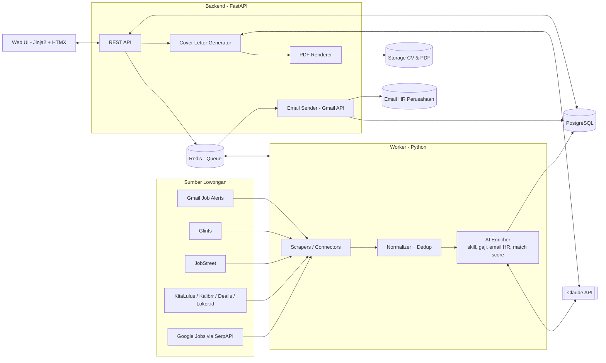
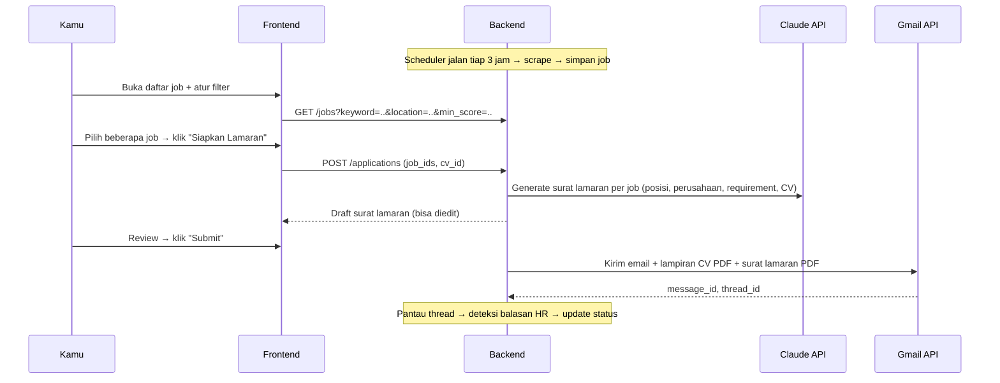
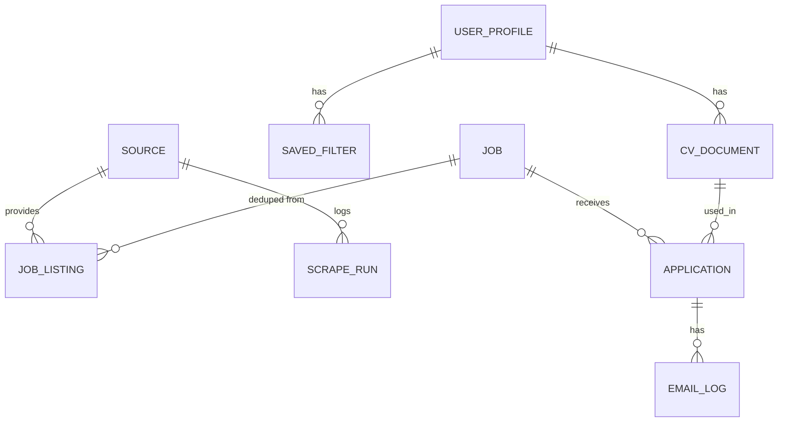

# Webotomatis Pencari Kerja — Dokumen Arsitektur

> Sistem pribadi untuk **mengumpulkan lowongan kerja di Indonesia** dari berbagai sumber, **memfilternya**, lalu **mengirim lamaran otomatis** (surat lamaran yang disesuaikan + CV) ke lowongan yang dipilih.

---

## 1. Apakah Bisa? (Studi Kelayakan)

**Bisa**, tapi ada batasan yang harus dipahami dari awal supaya desainnya benar.

| Sumber | Ambil lowongan | Kirim lamaran otomatis | Catatan |
|---|---|---|---|
| **Email job alert** (LinkedIn, JobStreet, Glints, dll. kirim ke Gmail) | ✅ Sangat aman | — | Sumber paling stabil & legal: cukup baca inbox via Gmail API |
| **Glints** | ✅ (API internal web, JSON) | ❌ Harus lewat platform | Scraping ringan, rate-limit |
| **JobStreet (SEEK)** | ✅ (API internal web) | ❌ Harus lewat platform | Scraping ringan, rate-limit |
| **KitaLulus** | ✅ | ⚠️ Sebagian lowongan mencantumkan email/WA HR | |
| **Kalibrr, Dealls, Karir.com, Loker.id, Jobs.id** | ✅ | ⚠️ Loker.id dkk sering mencantumkan email HR | |
| **LinkedIn** | ⚠️ Hanya via email alert / Google Jobs | ❌ **Jangan** auto-apply | Scraping langsung melanggar ToS & anti-bot agresif → akun bisa di-banned |
| **Google Jobs (via SerpAPI)** | ✅ Legal, berbayar (ada free tier) | — | Agregator yang sudah mencakup banyak situs |

### Kesimpulan penting
1. **Mengambil lowongan**: bisa dari hampir semua sumber.
2. **Mengirim lamaran otomatis**: hanya benar-benar otomatis jika lowongan **menyediakan email HR**. Portal seperti LinkedIn/JobStreet/Glints mewajibkan apply di dalam platform mereka (login + form). Mengotomatiskan itu (bot browser) berisiko akun di-banned dan melanggar ToS.
3. Maka sistem punya **2 mode apply**:
   - **Mode Email (full otomatis)** → sistem kirim email lamaran + CV PDF langsung ke HR.
   - **Mode Portal (semi otomatis)** → sistem membuat surat lamaran, menyalinnya ke clipboard, membuka link lowongan, dan menandai status “sudah apply” setelah kamu konfirmasi.

> Prinsip: **selalu ada preview sebelum kirim** (human-in-the-loop). Surat lamaran salah nama perusahaan = langsung gugur.

---

## 2. Gambaran Fitur

1. **Job Aggregator** — scraping terjadwal (mis. tiap 3 jam) dari semua sumber.
2. **Normalisasi & Deduplikasi** — lowongan yang sama di beberapa situs digabung jadi satu.
3. **Enrichment (AI)** — ekstrak skill, level pengalaman, gaji, email HR, lalu hitung **skor kecocokan** dengan CV kamu.
4. **Filter & Pencarian** — kategori role (Full Stack / Frontend / Backend / Mobile Flutter), keyword, lokasi, remote/WFO/hybrid, rentang gaji, tipe kerja, level, sumber, tanggal posting, skor kecocokan.
5. **Generate Surat Lamaran** — otomatis sesuai posisi, nama perusahaan, dan requirement lowongan (pakai LLM + template).
6. **Submit** — kirim email (Mode Email) atau bantu apply manual (Mode Portal).
7. **Application Tracker** — status: `draft → sent → replied → interview → offer / rejected`. Balasan HR dideteksi otomatis dari Gmail.
8. **Dashboard** — jumlah lamaran per minggu, response rate, dsb.

---

## 3. Profil Target (berdasarkan CV)

Sistem difokuskan ke **4 kategori role**. Setiap lowongan diberi `role_category` supaya filter, skor kecocokan, CV, dan surat lamaran bisa disesuaikan.

> Data kontak (no. HP, email, alamat) **tidak** ditulis di repo, tapi disimpan di tabel `user_profile` / `.env`, supaya aman kalau repo dipublikasikan.

**Ringkasan kandidat**
- Fresh graduate S1 Bisnis Digital ULBI (2022–2026), IPK 3,75.
- Sedang bekerja sebagai Backend Developer (MedCredix) & Frontend Developer (SIMRS) di PT SPKD (Okt 2026–sekarang).
- Pernah magang/proyek: Back End Developer PT Pos Indonesia, Mobile Developer JEC Eye Hospitals, BI Analyst (Dashboard KOL "Savvy").
- **Level target:** `entry` / `junior` (0–2 tahun). Lowongan yang minta ≥ 4 tahun pengalaman atau berlabel *Senior/Lead* otomatis diberi skor rendah.
- **Lokasi target:** Bekasi, Jakarta, Depok, Bogor, Tangerang (Jabodetabek), atau **Remote** di mana saja; Hybrid OK.

### 3.1 Kategori role & keyword pencarian

| `role_category` | Keyword pencarian (dipakai connector) | Skill CV yang cocok (untuk match score) |
|---|---|---|
| **fullstack** | full stack developer, fullstack engineer, web developer, software engineer | Next.js, React, Vue.js, TypeScript, Go/Gin, Node.js/Express, PHP, PostgreSQL, MySQL, Docker, REST API |
| **frontend** | frontend developer, front end engineer, react developer, next.js developer, vue developer, web developer | Next.js 16, React 19, Vue.js (Composition API, Pinia), TypeScript, Tailwind CSS, Zod, Figma |
| **backend** | backend developer, back end engineer, golang developer, node.js developer, php developer, api developer | Go (Gin, GORM), Node.js/Express, PHP, PostgreSQL, MySQL, JWT/RBAC, Swagger, Docker Compose, Caddy |
| **mobile** | flutter developer, mobile developer, android developer, mobile engineer | Flutter & Dart, Firebase/FCM, OCR, REST API integration, Google Sign-In |

Keyword **dikecualikan** (default): `senior`, `lead`, `principal`, `manager`, `head of`, `iOS native (Swift)`, `.NET`, `Java Spring` (bisa diubah di Settings).

### 3.2 Highlight per kategori (bahan surat lamaran)

Generator surat lamaran **memilih bukti yang relevan** dari CV sesuai kategori, bukan menempelkan semua pengalaman:

| Kategori | Pengalaman yang ditonjolkan |
|---|---|
| **fullstack** | SIMRS (Next.js + TypeScript) & MedCredix (Go + PostgreSQL) di PT SPKD; Website Carter ULBI (PHP + MySQL + Midtrans/RajaOngkir, end-to-end sampai deploy) |
| **frontend** | Dashboard SIMRS (Next.js 16, React 19, Tailwind, Zod, RBAC per peran, 9 modul RS); SecuraKost & Toko Kelontong Online (Vue.js, Pinia); desain UI di Figma |
| **backend** | MedCredix: 44 endpoint REST (Go/Gin, GORM), skema 33 tabel, JWT + RBAC, enkripsi AES-256-GCM, integrasi FHIR, deploy Docker Compose + Caddy; IHSAN POS untuk PT Pos Indonesia (dipublikasikan di JUISI) |
| **mobile** | Aplikasi Android JEC Eye Hospitals (Flutter, OCR KTP, FCM, Google Sign-In, face login, SUS 79 dari 120 responden); Digimize (Flutter + PHP API, nilai A) |

Nilai tambah yang bisa disebut di semua kategori: analisis sistem (UML, ERD, SDLC), sertifikasi SAP, dan pendanaan P2MW Kemendikbudristek.

### 3.3 Strategi CV
- **Fase awal:** satu CV master (PDF yang sudah ada) dilampirkan untuk semua lamaran. Penyesuaian dilakukan lewat surat lamaran.
- **Fase lanjut (opsional):** 4 varian CV di `cv_document` (`role_category` = fullstack / frontend / backend / mobile) dengan urutan "Kemampuan Utama" & pengalaman yang disusun ulang. Sistem otomatis memilih varian sesuai kategori lowongan.

### 3.4 Contoh kerangka surat lamaran (Bahasa Indonesia)

```
Yth. Tim Rekrutmen {company_name},

Saya {full_name}, lulusan S1 Bisnis Digital Universitas Logistik dan Bisnis
Internasional (IPK 3,75), ingin melamar posisi {job_title} di {company_name}.

{paragraf_relevansi}   ← dibuat AI: 2–3 bukti dari tabel 3.2 yang paling cocok
                         dengan requirement lowongan, lengkap dengan angka/hasil.

{paragraf_motivasi}    ← dibuat AI: kenapa tertarik dengan {company_name}
                         (berdasarkan deskripsi lowongan/perusahaan).

Bersama email ini saya lampirkan CV dan portofolio. Saya berharap dapat
berdiskusi lebih lanjut. Terima kasih atas waktu dan perhatian Bapak/Ibu.

Hormat saya,
{full_name}
{phone} | {email} | {portfolio_url}
```
Versi Bahasa Inggris dipakai otomatis bila iklan lowongan berbahasa Inggris.

---

## 4. Arsitektur Sistem



### Pola arsitektur: Monolith (1 codebase, 2 proses)

Backend & frontend **tidak dipisah**. Satu aplikasi FastAPI merender halaman HTML (Jinja2) dan HTMX hanya meminta potongan HTML saat filter/aksi dipakai, jadi tidak perlu API JSON terpisah untuk UI.

```
┌──────────────── 1 codebase Python ────────────────┐
│                                                   │
│  web (FastAPI + Uvicorn)        worker (ARQ)      │
│  ├─ /jobs, /applications ...    ├─ scrape_all     │
│  │   → HTML (Jinja2 + HTMX)     ├─ enrich_job     │
│  └─ /api/... (opsional, JSON)   ├─ send_email     │
│            │                    └─ check_replies  │
│            └──── services/ (logic bersama) ───┘   │
└───────────────────────────────────────────────────┘
          │                     │
     PostgreSQL              Redis (antrean + cron)
```

- **web** → melayani tampilan & aksi user. Tidak pernah melakukan scraping/kirim email langsung; hanya memasukkan tugas ke antrean.
- **worker** → mengerjakan tugas berat/lama di belakang (scraping, panggilan AI, kirim email, cek balasan).
- Docker Compose: `web`, `worker`, `postgres`, `redis`.
- **Kenapa monolith:** pengguna tunggal, satu bahasa, satu deploy, lebih cepat jadi. Kalau nanti butuh app mobile, cukup tambah router `/api/...` yang memakai `services/` yang sama.

Aturan supaya tetap rapi: **router tipis, logic di `services/`**. Router web & router API sama-sama hanya memanggil service, jadi logic tidak terduplikasi.

### Alur utama



---

## 5. Tech Stack

| Layer | Pilihan | Alasan |
|---|---|---|
| **Bahasa backend** | Python 3.12 | Ekosistem scraping & AI paling lengkap |
| **Web framework** | FastAPI | Cepat, async, auto-docs (Swagger) |
| **Scraping** | `httpx` (API JSON), `selectolax` (parse HTML), **Playwright** (situs yang butuh render JS) | Ringan dulu, browser hanya bila perlu |
| **Job queue / scheduler** | Redis + **ARQ** (atau Celery) + cron | Scrape terjadwal & kirim email antre (rate-limit) |
| **Database** | PostgreSQL 16 + **SQLAlchemy 2 / Alembic** | Full-text search, JSONB untuk data mentah |
| **AI / LLM** | **Claude API** (`claude-sonnet-5-5`; `claude-haiku-5-5` untuk ekstraksi massal yang murah) | Surat lamaran natural (ID/EN), ekstraksi data terstruktur |
| **PDF** | Jinja2 + **WeasyPrint** | Template HTML → PDF surat lamaran rapi |
| **Email** | **Gmail SMTP + App Password** (aiosmtplib) untuk kirim; Gmail API/IMAP menyusul untuk baca balasan & job alert | Setup paling sederhana: cukup App Password, tanpa Google Cloud project |
| **Frontend** | **Jinja2 + HTMX + CSS biasa dengan design tokens** (tanpa build step), dirender langsung oleh FastAPI | Semua di Python, tanpa project frontend & tanpa Node; filter & tabel tetap interaktif tanpa reload |
| **Auth** | Single user dulu (password + JWT) | Ini tool pribadi |
| **Deploy** | Docker Compose (lokal / VPS murah) | Satu perintah jalan semua |

> **Opsi lebih sederhana (MVP 1 minggu):** FastAPI + SQLite + APScheduler (tanpa Redis). Bisa upgrade ke PostgreSQL + Redis nanti.

---

## 6. Model Data



### Tabel inti

**`user_profile`** — data diri untuk surat lamaran
`id, full_name, email, phone, address, linkedin_url, portfolio_url, summary, skills[], experience_years, preferred_language (id/en), signature`

**`cv_document`**
`id, user_id, title (mis. "CV Backend Dev"), role_category (nullable), file_path, parsed_text, is_default, created_at`
> Boleh punya beberapa CV (mis. versi Data Analyst & versi Developer), sistem pilih yang paling cocok.

**`source`**
`id, name (glints, jobstreet, ...), base_url, type (api|html|email|serpapi), is_active, rate_limit_per_min`

**`job`** — lowongan hasil dedup (yang tampil di UI)
```
id, title, company_name, company_logo_url, role_category (fullstack|frontend|backend|mobile|other),
location_city, location_province, work_mode (onsite|remote|hybrid),
employment_type (fulltime|contract|internship|freelance),
experience_level (entry|junior|mid|senior),
salary_min, salary_max, salary_currency, salary_is_estimated,
description, requirements, skills[] ,
hr_email, hr_whatsapp, apply_url, apply_mode (email|portal),
posted_at, expires_at, match_score (0-100),
dedup_hash, status (new|seen|saved|hidden|applied),
created_at, updated_at
```

**`job_listing`** — data mentah per sumber
`id, job_id, source_id, external_id, url, raw_payload (JSONB), scraped_at`

**`application`**
```
id, job_id, cv_id, cover_letter_text, cover_letter_pdf_path,
email_subject, sent_to, apply_mode,
status (draft|queued|sent|failed|replied|interview|offer|rejected),
gmail_message_id, gmail_thread_id, sent_at, last_reply_at, notes
```

**`email_log`** — `id, application_id, direction (out|in), subject, snippet, at`
**`saved_filter`** — `id, user_id, name, query (JSONB), notify (bool)`
**`scrape_run`** — `id, source_id, started_at, finished_at, jobs_found, jobs_new, error`

### Deduplikasi
`dedup_hash = sha1(normalize(company_name) + normalize(title) + normalize(city))`
Jika hash sama dari sumber berbeda → satu `job`, banyak `job_listing`.

---

## 7. Komponen Detail

### 7.1 Connector (Scraper)
Setiap sumber = satu class dengan interface yang sama, jadi gampang menambah sumber baru:

```python
class JobConnector(Protocol):
    name: str
    async def fetch(self, query: SearchQuery) -> list[RawJob]: ...
    def normalize(self, raw: RawJob) -> JobIn: ...
```

Aturan main scraping:
- Utamakan **endpoint JSON** yang dipakai web itu sendiri, baru HTML, terakhir Playwright.
- Rate-limit (mis. 1 request / 2–3 detik per situs), User-Agent wajar, hormati `robots.txt`.
- Hanya untuk **penggunaan pribadi**, jangan dipublikasikan ulang datanya.
- Simpan `raw_payload` supaya kalau parser rusak, bisa diproses ulang tanpa scrape lagi.

### 7.2 Gmail Job Alert Parser
- Buat label Gmail “Job Alerts”, langganan alert dari LinkedIn, JobStreet, Glints, dll.
- Worker membaca email baru via Gmail API → ekstrak link & judul lowongan → (opsional) ambil detail dari link.
- Cara **paling legal** untuk mendapatkan lowongan LinkedIn.

### 7.3 AI Enricher
Untuk setiap job baru, LLM mengembalikan JSON terstruktur:
```json
{ "skills": ["Python","SQL"], "experience_level": "junior",
  "salary_min": 6000000, "salary_max": 9000000,
  "hr_email": "recruitment@pt-abc.co.id", "work_mode": "hybrid",
  "match_score": 82, "match_reason": "Cocok di Python & SQL, kurang di AWS" }
```
Gunakan model murah (Haiku) untuk ini karena volumenya besar; regex dulu untuk email/gaji agar hemat.

### 7.4 Cover Letter Generator
Input: profil kamu + CV (teks) + job (judul, perusahaan, requirement) + bahasa lowongan.
Output: surat lamaran 3–4 paragraf, menyebut **posisi & nama perusahaan yang benar**, menyorot skill yang relevan.

Pengaman:
- Validasi otomatis: nama perusahaan & posisi **harus** muncul di surat; tidak boleh ada placeholder `[...]`.
- Bahasa mengikuti bahasa iklan lowongan (Indonesia / Inggris).
- Tidak boleh mengarang pengalaman yang tidak ada di CV (instruksi di prompt).

### 7.5 Email Sender
- Subject default: `Lamaran Pekerjaan - {Posisi} - {Nama Lengkap}` (atau format yang diminta di iklan — enricher mendeteksi ini).
- Lampiran: `CV_{Nama}.pdf` + `Surat_Lamaran_{Perusahaan}.pdf`.
- **Rate limit**: maks ~20–30 email/hari, jeda acak 1–3 menit antar email → tidak dianggap spam.
- Cegah double-apply: satu `job` hanya boleh satu `application` berstatus `sent`.

### 7.6 Reply Tracker
Worker cek `gmail_thread_id` tiap 30 menit → jika ada balasan, status jadi `replied` dan LLM klasifikasi: undangan interview / penolakan / lainnya.

---

## 8. API Endpoint (Backend)

| Method | Endpoint | Fungsi |
|---|---|---|
| GET | `/jobs` | List job + filter (`q, role_category, location, work_mode, salary_min, level, source, posted_within, min_score, status`) |
| GET | `/jobs/{id}` | Detail job |
| PATCH | `/jobs/{id}` | Ubah status (save/hide) |
| POST | `/scrape/run` | Trigger scraping manual |
| GET/PUT | `/profile` | Data diri |
| POST/GET | `/cvs` | Upload / list CV |
| POST | `/applications` | Buat draft lamaran untuk 1..n job (generate surat) |
| PUT | `/applications/{id}` | Edit draft surat |
| POST | `/applications/{id}/submit` | Kirim (email) / tandai sudah apply (portal) |
| GET | `/applications` | Tracker lamaran |
| GET/POST | `/filters` | Simpan filter favorit |
| GET | `/stats` | Data dashboard |

---

## 9. Halaman Frontend

1. **Jobs** — tabel/kartu lowongan, panel filter di samping, badge sumber & skor kecocokan, checkbox multi-pilih.
2. **Job Detail** — deskripsi, requirement, alasan match, tombol “Siapkan Lamaran”.
3. **Review Lamaran** — preview surat (editable), pilih CV, lihat penerima email → **Submit**.
4. **Tracker** — kanban: Sent / Replied / Interview / Offer / Rejected.
5. **Profil & CV** — data diri, upload CV, template surat.
6. **Settings** — koneksi Gmail, sumber aktif, jadwal scraping, batas email harian.

> Panduan desain visual, komponen, wireframe, dan aturan "anti AI slop" ada di **[UI_GUIDELINES.md](UI_GUIDELINES.md)**.

---

## 10. Struktur Folder

```
webotomatis-pencari-kerja/
├── backend/
│   ├── app/
│   │   ├── api/            # router FastAPI
│   │   ├── core/           # config, security, db session
│   │   ├── models/         # SQLAlchemy models
│   │   ├── schemas/        # Pydantic
│   │   ├── services/
│   │   │   ├── cover_letter.py
│   │   │   ├── enricher.py
│   │   │   ├── gmail.py
│   │   │   └── pdf.py
│   │   ├── connectors/     # glints.py, jobstreet.py, kitalulus.py, gmail_alerts.py, serpapi.py ...
│   │   ├── workers/        # tugas ARQ: scrape, enrich, send_email, check_replies
│   │   ├── web/            # router halaman (render Jinja2 + HTMX)
│   │   ├── templates/
│   │   │   ├── pages/      # jobs.html, job_detail.html, review.html, tracker.html, profile.html, settings.html
│   │   │   ├── partials/   # potongan HTML yang di-swap HTMX (tabel job, kartu, modal)
│   │   │   └── letters/    # template HTML surat lamaran → PDF
│   │   └── static/         # css/app.css (tokens), js/htmx.min.js, js/app.js, fonts/ (IBM Plex)
│   ├── alembic/
│   └── tests/
├── storage/                # CV & PDF (di-.gitignore)
├── docker-compose.yml
├── .env.example
└── ARCHITECTURE.md
```

---

## 11. Konfigurasi (`.env`)

```
DATABASE_URL=postgresql+asyncpg://user:pass@db:5432/jobs
REDIS_URL=redis://redis:6379
ANTHROPIC_API_KEY=...
SERPAPI_KEY=...                 # opsional
GOOGLE_CLIENT_ID=...            # Gmail OAuth
GOOGLE_CLIENT_SECRET=...
MAX_EMAILS_PER_DAY=25
SCRAPE_INTERVAL_HOURS=3
```
> Jangan pernah commit `.env`, CV, atau token Gmail ke Git.

---

## 12. Roadmap

| Fase | Isi | Hasil |
|---|---|---|
| **0. Setup** ✅ | Repo, Docker Compose, DB, skeleton FastAPI + template Jinja2/HTMX | Project jalan |
| **1. Aggregator** 🟡 | ✅ JobStreet, ✅ Kalibrr, ✅ dedup, ✅ halaman Lowongan + filter, ✅ skor sementara berbasis kata kunci · ⬜ Glints, ⬜ Gmail alert, ⬜ detail lengkap JobStreet | Bisa lihat semua lowongan di 1 tempat |
| **2. AI** | Enricher (skill, gaji, email HR) + match score | Lowongan terurut dari yang paling cocok |
| **3. Apply** 🟡 | ✅ pilih lowongan → draft, ✅ surat AI (Claude) / template CV, ✅ pemeriksaan surat, ✅ kirim email via SMTP + lampiran CV (antrean, jeda, kuota harian), ✅ Mode Portal, ✅ pelacak status ✅ halaman Profil (data diri, CV, kalimat & bukti surat) · ⬜ PDF surat lamaran | Bisa melamar dengan 1 klik |
| **4. Tracking** | Reply tracker, kanban, dashboard | Tahu lamaran mana yang direspon |
| **5. Ekspansi** | KitaLulus, Kalibrr, Dealls, Loker.id, SerpAPI, notifikasi Telegram untuk job baru yang skornya tinggi | Cakupan lebih luas |

---

## 13. Risiko & Etika

- **ToS platform**: scraping & bot apply bisa membuat akun diblokir. Desain ini sengaja tidak auto-apply di dalam portal.
- **Spam**: kirim lamaran massal tanpa personalisasi justru menurunkan peluang. Batasi jumlah, pastikan skor cocok, review dulu.
- **Data pribadi (UU PDP No. 27/2022)**: CV & data diri disimpan lokal/terenkripsi, tidak dibagikan.
- **Lowongan palsu/penipuan**: tandai lowongan yang meminta biaya, domain email gratisan mencurigakan, atau gaji tidak masuk akal (enricher bisa memberi `scam_flag`).
- **Scraper rapuh**: situs berubah → connector rusak. Karena itu tiap connector terisolasi, ada `scrape_run` log & test.
