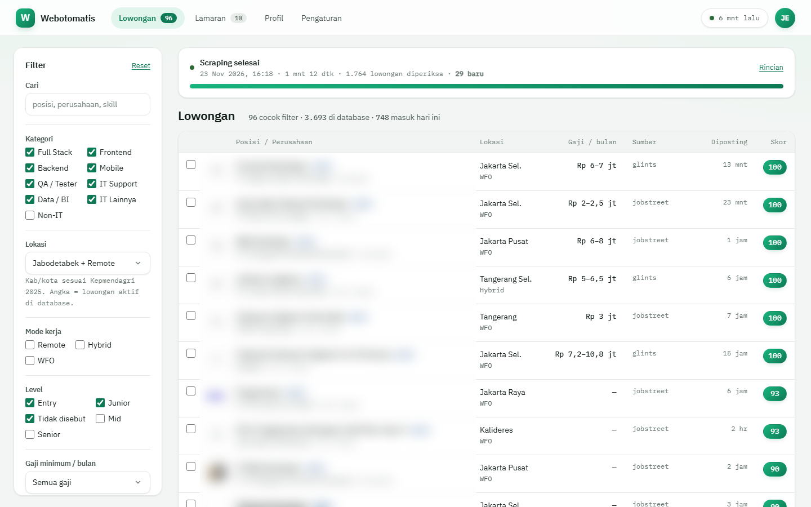
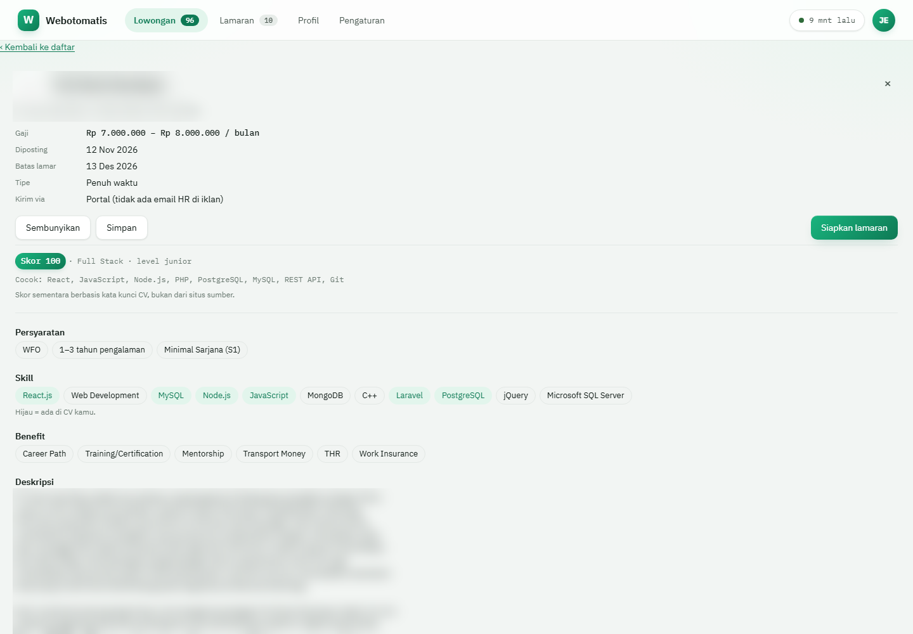
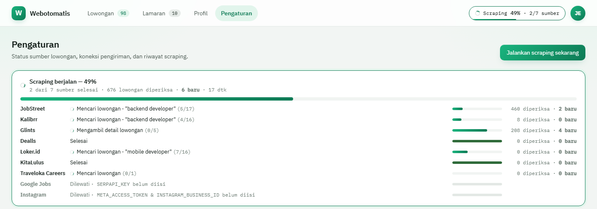
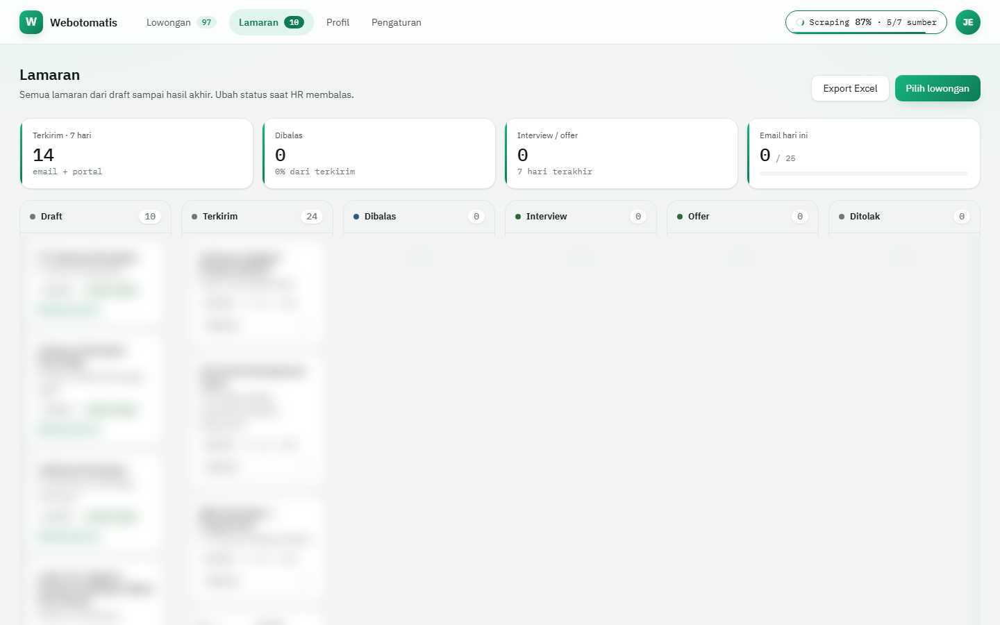

# Webotomatis Pencari Kerja

Asisten pribadi untuk mencari kerja di Indonesia. Aplikasi ini mengumpulkan lowongan **asli** dari banyak portal
(JobStreet, Glints, Kalibrr, Dealls, Loker.id, KitaLulus, Traveloka Careers, Google Jobs, dan akun info loker Instagram),
menyaringnya sesuai profil Anda, lalu membantu menyiapkan dan mengirim lamaran.

Untuk setiap lowongan, aplikasi menulis **surat lamaran yang disesuaikan**: nama perusahaan, posisi, dan persyaratannya.
Surat itu dikirim lewat email bersama CV Anda.

> Semua data lowongan berasal dari situs sumber. Tidak ada data contoh atau dummy.

- Arsitektur & keputusan teknis: [ARCHITECTURE.md](ARCHITECTURE.md)
- Panduan desain UI: [UI_GUIDELINES.md](UI_GUIDELINES.md)

---

## Tampilan

**Daftar lowongan.** Filter di kiri, progres scraping terakhir di atas, lowongan diurutkan menurut skor kecocokan dengan CV.



**Detail lowongan.** Isi lengkap dari situs sumber: gaji, batas lamar, persyaratan, skill (hijau = ada di CV), benefit, dan deskripsi.



**Progres scraping.** Status tiap sumber saat scraping berjalan: kata kunci yang sedang dicari, jumlah lowongan diperiksa, dan lowongan baru.



**Pelacak lamaran.** Papan status dari Draft sampai Offer/Ditolak, beserta ringkasan dan kuota email harian.



> Nama posisi, perusahaan, logo, dan deskripsi lowongan pada screenshot sengaja diburamkan.

---

## Daftar isi

1. [Fitur](#fitur)
2. [Yang perlu disiapkan](#yang-perlu-disiapkan)
3. [Instalasi (pertama kali)](#instalasi-pertama-kali)
4. [Pengaturan awal di aplikasi](#pengaturan-awal-di-aplikasi)
5. [Cara memakai sehari-hari](#cara-memakai-sehari-hari)
6. [Mengaktifkan fitur tambahan](#mengaktifkan-fitur-tambahan)
7. [Daftar isi `.env`](#daftar-isi-env)
8. [Perintah berguna](#perintah-berguna)
9. [Menjaga data tetap aman](#menjaga-data-tetap-aman)
10. [Mengatasi masalah](#mengatasi-masalah)
11. [Struktur proyek & tech stack](#struktur-proyek--tech-stack)
12. [Catatan & batasan](#catatan--batasan)

---

## Fitur

| Fitur | Keterangan |
|---|---|
| **Kumpulkan lowongan otomatis** | Scraping berjalan tiap 3 jam di latar belakang. Hanya lowongan **3 hari terakhir** yang diambil. |
| **Mengikuti CV siapa pun** | Bidang & keyword pencarian diturunkan dari CV aktif (pengalaman, magang, proyek, skill), masing-masing dengan dasarnya di CV. CV developer → lowongan IT; CV marketing/admin → lowongan marketing/admin. Bisa diedit di **Profil → Target pencarian**. |
| **Bidang IT & non-IT** | IT (Full Stack, Frontend, Backend, Mobile, QA, IT Support, Data/BI, IT lainnya) dan non-IT (Marketing, Kreatif & Konten, Sales, Admin, Customer Service, Keuangan, HR, Operasional, Teknik, Pendidikan, Kesehatan, Hotel/F&B/Retail). JobStreet menyapu seluruh kategori yang sesuai bidang CV. |
| **Isi lowongan lengkap** | Deskripsi, kualifikasi, skill, benefit, pendidikan, gaji, dan batas lamaran diambil dari halaman detail, sama seperti di situs aslinya. |
| **Tanpa duplikat** | Lowongan yang sama di beberapa portal digabung jadi satu, lengkap dengan semua tautannya. |
| **Filter & pencarian** | Per bidang, level, lokasi (kab/kota Kepmendagri), gaji, sumber, dan tanggal. Filter awal mengikuti CV: bidang target, level sesuai lama pengalaman, dan provinsi domisili. |
| **Skor kecocokan** | Bidang lowongan vs bidang CV, level vs lama pengalaman, dan skill CV yang disebut iklan (soft skill tidak dihitung). Yang paling cocok tampil paling atas. |
| **Surat lamaran otomatis** | Ditulis oleh **Gemini** (atau Claude) dalam Bahasa Indonesia/Inggris formal, tanpa kalimat klise. Tanpa API key AI, aplikasi memakai template dari bukti CV. |
| **Pemeriksaan sebelum kirim** | Nama perusahaan, posisi, panjang surat, placeholder yang tertinggal, kuota email, dan lain-lain. |
| **Kirim email + CV** | Lewat Gmail (App Password). Ada batas harian dan jeda antar email supaya akun aman. |
| **Mode portal** | Untuk lowongan yang wajib apply di situsnya: salin surat, buka lowongan, lalu tandai "sudah apply". |
| **Pelacak lamaran** | Papan status: Draft → Terkirim → Dibalas → Interview → Offer / Ditolak. |
| **Profil & banyak CV** | Unggah beberapa CV (misalnya CV Mobile khusus lowongan Flutter). CV yang tepat dipilih otomatis. |

### Sumber lowongan

| Sumber | Cara ambil | Perlu kunci? |
|---|---|---|
| JobStreet | API pencarian publik + halaman detail | Tidak |
| Glints | Data halaman + halaman detail | Tidak |
| Kalibrr | API publik | Tidak |
| Dealls | API publik + halaman detail | Tidak |
| Loker.id, KitaLulus | Data terstruktur (JSON-LD) di halaman | Tidak |
| Traveloka Careers | API karir publik | Tidak |
| Google Jobs (ribuan situs karir perusahaan) | SerpApi | `SERPAPI_KEY` (gratis ±100 pencarian/bulan) |
| Instagram (akun info loker) | API resmi Meta + Gemini membaca poster | Token Meta + Gemini |

---

## Yang perlu disiapkan

### Wajib

| Kebutuhan | Untuk apa | Link |
|---|---|---|
| **Docker Desktop** | Menjalankan seluruh aplikasi (database, web, worker) tanpa instal Python/PostgreSQL manual | https://www.docker.com/products/docker-desktop/ |
| **Git** | Mengunduh (clone) proyek ini | https://git-scm.com/downloads |
| **CV dalam PDF** (maks. 5 MB) | Dilampirkan ke email & dibaca AI untuk menulis surat | – |
| Komputer dengan **RAM ≥ 8 GB** | Docker butuh ±2 GB untuk aplikasi ini | – |

> Pengguna Windows: saat instal Docker Desktop, pilih **WSL 2** bila ditanya, lalu restart komputer.

### Sangat disarankan

| Kebutuhan | Untuk apa | Biaya |
|---|---|---|
| **Akun Gmail dengan 2-Step Verification** | Mengirim lamaran lewat email (App Password) | Gratis |
| **Gemini API key** (Google AI Studio) | Menulis surat lamaran yang benar-benar disesuaikan per lowongan | Ada kuota gratis |

### Opsional

| Kebutuhan | Untuk apa | Biaya |
|---|---|---|
| **SerpApi key** | Lowongan dari situs karir perusahaan lewat Google Jobs | Gratis ±100 pencarian/bulan |
| **Akun Instagram profesional + Halaman Facebook + aplikasi Meta** | Membaca postingan akun info loker di Instagram | Gratis |
| DBeaver / TablePlus | Melihat isi database langsung | Gratis |

---

## Instalasi (pertama kali)

### 1. Clone proyek

```bash
git clone https://github.com/<username>/<nama-repo>.git
cd <nama-repo>
```

### 2. Buat file `.env`

`.env` berisi semua pengaturan & kunci rahasia Anda. File ini **tidak ikut** ke GitHub.

```bash
# macOS / Linux / Git Bash
cp .env.example .env

# Windows PowerShell
Copy-Item .env.example .env
```

Untuk percobaan pertama, `.env` boleh dibiarkan apa adanya. Scraping tetap jalan tanpa kunci apa pun.
Kunci-kunci lain bisa diisi belakangan (lihat [Mengaktifkan fitur tambahan](#mengaktifkan-fitur-tambahan)).

### 3. Jalankan

Pastikan Docker Desktop **sudah terbuka dan statusnya running**, lalu:

```bash
docker compose up -d --build
```

Build pertama memakan waktu ±3–5 menit. Setelah selesai, buka **http://localhost:8030**.

Yang terjadi otomatis:
- **web** menyiapkan tabel database (migrasi), lalu menyajikan tampilan.
- **worker** langsung mulai scraping semua sumber, lalu mengulanginya tiap 3 jam.
  Putaran pertama butuh ±5–10 menit. Pantau dengan `docker compose logs -f worker`.

### 4. Cek semua berjalan

```bash
docker compose ps
```

Empat layanan harus berstatus *running*: `postgres`, `redis`, `web`, `worker`.

---

## Pengaturan awal di aplikasi

Lakukan sekali sebelum mengirim lamaran.

### 1. Isi profil (menu **Profil**)

- **Nama lengkap, email, LinkedIn, portofolio.** Data ini dipakai di tanda tangan surat.
  Email profil juga dipakai sebagai *Reply-To*, jadi balasan HRD masuk ke sana.
- Nomor HP boleh diisi untuk data diri. Nomor ini **tidak** dicantumkan di surat.

### 2. Unggah CV

- Unggah PDF lalu jadikan **default**.
- Punya CV khusus (misalnya CV Mobile)? Unggah juga dan khususkan untuk kategori tersebut.
  Untuk lowongan Flutter, CV itu otomatis yang dilampirkan.
- Periksa **teks yang terbaca** dari PDF. Teks itulah yang dibaca AI. Kalau kosong, berarti PDF berupa gambar hasil scan;
  ekspor ulang CV dari Word/Google Docs/Canva sebagai PDF teks.

### 3. Kalimat surat & bukti CV (opsional)

Bahan untuk surat **template** (dipakai bila tidak ada API key AI atau AI sedang gangguan).
Klik **Salin contoh bawaan** sebagai titik awal, lalu sesuaikan dengan pengalaman Anda.

### 4. Sesuaikan target pencarian (opsional)

Keyword pencarian, skill CV, serta aturan kategori dan level ada di
[`backend/app/services/targeting.py`](backend/app/services/targeting.py).
Kalau Anda bukan orang IT, ubah keyword dan skill di file itu, lalu jalankan:

```bash
docker compose exec web python -m app.scripts.rescore
```

---

## Cara memakai sehari-hari

### Menu **Lowongan**

1. Atur filter di kiri (kategori, level, lokasi, mode kerja, gaji, skor, sumber, tanggal), lalu klik **Terapkan**.
2. Klik sebuah lowongan untuk membuka **detail lengkap**: deskripsi, kualifikasi, skill, benefit, dan tautan ke situs aslinya.
   Skill berwarna hijau berarti ada di CV Anda. **Perbarui dari situs sumber** mengambil ulang isi terbaru.
3. Tombol pada lowongan:
   - **Simpan**: tandai untuk nanti.
   - **Sembunyikan**: tidak akan muncul lagi.
   - **Siapkan lamaran**: langsung untuk satu lowongan, atau klik **Pilih lowongan**, centang beberapa, lalu **Siapkan lamaran**.
4. Shortcut keyboard: `j`/`k` untuk lowongan berikut/sebelumnya, `/` untuk pencarian, `Esc` untuk menutup detail.

### Menu **Lamaran**

1. Lowongan yang dipilih masuk ke kolom **Draft** dan suratnya langsung dibuat.
2. Buka satu lamaran untuk **review**:
   - Baca dan edit surat bila perlu (subjek email juga bisa diubah), lalu **Simpan**.
   - Pilih bahasa (Indonesia/English) dan klik **Buat ulang** untuk membuat versi baru.
   - Lihat panel **Pemeriksaan**. Item merah harus dibereskan dulu, misalnya posisi belum disebut atau email HRD tidak ada.
3. Pilih cara kirim:
   - **Email ke HR**: bila lowongan mencantumkan email HRD. Surat dan CV dikirim dari Gmail Anda.
   - **Lewat situs lowongan**: klik **Salin surat & buka lowongan ↗**, apply di situsnya, lalu klik **Sudah apply**.
   - **Lewati** bila batal melamar.
4. Status lamaran: Draft → Antre → Terkirim (atau Gagal) → Dibalas → Interview → Offer / Ditolak.
   Ubah status lewat **Ubah status** saat ada kabar dari perusahaan.

### Menu **Pengaturan**

- Status tiap sumber (terakhir jalan, jumlah lowongan, error).
- **Jalankan scraping sekarang** bila tidak ingin menunggu jadwal 3 jam.
- Daftar akun Instagram info loker (bila Instagram aktif).
- Riwayat scraping lengkap.

---

## Mengaktifkan fitur tambahan

Setiap kali `.env` diubah, terapkan dengan:

```bash
docker compose up -d --force-recreate web worker
```

### A. Kirim lamaran lewat Gmail

1. Aktifkan **2-Step Verification** di akun Google: https://myaccount.google.com/security
2. Buat **App Password** di https://myaccount.google.com/apppasswords. Nama bebas, misalnya `webotomatis`.
   Google menampilkan 16 huruf; salin semuanya.
3. Isi `.env`:
   ```env
   SMTP_USER=alamatanda@gmail.com
   SMTP_PASSWORD=abcd efgh ijkl mnop
   ```
   Spasi di App Password boleh ikut ditulis.
4. Terapkan perubahan (perintah di atas). Status SMTP di menu **Pengaturan** akan berubah jadi aktif.

Batas aman bawaan: **25 email/hari** (`MAX_EMAILS_PER_DAY`) dan jeda minimal **90 detik** antar email.
Tanpa SMTP, lamaran tetap bisa diproses lewat **mode portal**.

### B. Surat lamaran dengan Gemini (AI)

1. Buat API key di **Google AI Studio**: https://aistudio.google.com/apikey
   (terpisah dari langganan aplikasi Gemini; API-nya punya kuota gratis).
2. Isi `.env`:
   ```env
   GEMINI_API_KEY=isi_api_key_anda
   GEMINI_MODEL=gemini-3.5-flash
   GEMINI_FALLBACK_MODELS=["gemini-3.5-flash-lite"]
   GEMINI_THINKING_LEVEL=low
   ```
3. Terapkan perubahan.

Cara kerja surat:
- Salam pembuka (*Perihal*, *Yth. HRD …*, *Dengan hormat*) dan tanda tangan selalu disusun sistem, jadi formatnya konsisten.
- Isi surat ditulis dari **teks CV + persyaratan lowongan**. Skill yang tidak ada di CV tidak akan diklaim.
- Bila model utama sibuk atau kena limit, model cadangan dicoba. Bila semua gagal, surat disusun dari template
  dan alasannya ditampilkan di halaman review. Klik **Buat ulang** untuk mencoba lagi.
- Alternatif: isi `ANTHROPIC_API_KEY` untuk memakai Claude. Gemini tetap diutamakan bila keduanya terisi.

### C. Google Jobs (situs karir perusahaan)

1. Daftar di https://serpapi.com (paket gratis ±100 pencarian/bulan), lalu salin **API Key** dari dashboard.
2. Isi `.env`:
   ```env
   SERPAPI_KEY=isi_api_key_anda
   SERPAPI_MAX_SEARCHES_PER_DAY=3
   ```
3. Terapkan perubahan.

Supaya kuota gratis cukup sebulan, Google Jobs hanya berjalan **sekali sehari** dengan 3 pencarian.
Tautan lamaran mengutamakan situs karir perusahaan dibanding portal agregator.

### D. Instagram (akun info loker)

Memakai **API resmi Meta (Business Discovery)**, bukan scraping, sehingga akun Anda aman dari blokir.
Postingan **3 hari terakhir** dari akun info loker dibaca Gemini (gambar poster + caption) menjadi lowongan.
Fitur ini **butuh Gemini aktif**.

Setup sekali, sekitar 20–30 menit:

1. **Jadikan Instagram Anda akun profesional.** Di Instagram: *Settings* → *Account type and tools* →
   *Switch to professional account* → pilih **Business**. Kategori bebas (misalnya *Personal blog*), info kontak boleh dilewati.
2. **Buat Halaman Facebook.** Halaman (Page), bukan profil pribadi: https://www.facebook.com/pages/create
   → pilih **Public Page** → isi nama & kategori → langkah lain boleh di-*Skip*.
3. **Hubungkan Halaman ke Instagram.** Beralih ke Halaman (foto profil kanan atas → pilih Halaman) →
   *Settings* → *Linked accounts* → *Instagram* → *Connect account* → login Instagram.
   Cara lain: Meta Business Suite → *Settings* → *Instagram accounts* → *Connect*.
4. **Buat aplikasi Meta.** https://developers.facebook.com → daftar sebagai developer → *My Apps* → *Create App*
   → use case **Other** → tipe **Business**.
5. **Buat token.** Buka *Graph API Explorer* (https://developers.facebook.com/tools/explorer) → pilih aplikasi Anda →
   *User Token* → tambahkan izin `instagram_basic`, `pages_show_list`, `pages_read_engagement`, `business_management`
   → *Generate Access Token* → centang Halaman & akun Instagram Anda.
6. **Ambil ID akun bisnis.** Di Explorer jalankan:
   ```
   me/accounts?fields=name,instagram_business_account
   ```
   Salin angka `id` yang ada **di dalam** `instagram_business_account`.
7. **Perpanjang token (±60 hari).** Buka *Access Token Debugger* (https://developers.facebook.com/tools/debug/accesstoken)
   → tempel token → *Debug* → *Extend Access Token* → salin token baru.
8. Isi `.env`:
   ```env
   META_ACCESS_TOKEN=token_panjang_dari_langkah_7
   INSTAGRAM_BUSINESS_ID=angka_dari_langkah_6
   ```
   lalu terapkan perubahan.
9. Cek koneksi:
   ```bash
   docker compose exec web python -m app.scripts.ig_check
   docker compose exec web python -m app.scripts.ig_check namaakuninfoloker   # cek satu akun
   ```
10. Tambahkan akun-akun info loker di **Pengaturan → Akun Instagram info loker**.

Hanya akun Instagram **bisnis/kreator** yang bisa dibaca (umumnya akun info loker memang bisnis).
Token berlaku ±60 hari; ulangi langkah 5–8 bila di Pengaturan muncul error token kedaluwarsa.
Nama menu Meta bisa sedikit berbeda karena tampilannya rutin diperbarui.

---

## Daftar isi `.env`

| Variabel | Default | Keterangan |
|---|---|---|
| `GEMINI_API_KEY` | – | API key Google AI Studio, untuk surat AI & membaca poster Instagram |
| `GEMINI_MODEL` | `gemini-3.5-flash` | Model utama |
| `GEMINI_FALLBACK_MODELS` | `["gemini-3.5-flash-lite"]` | Model cadangan (format JSON list) |
| `GEMINI_THINKING_LEVEL` | `low` | `minimal` / `low` / `medium` / `high` |
| `ANTHROPIC_API_KEY` | – | Opsional, Claude sebagai alternatif Gemini |
| `SMTP_HOST` / `SMTP_PORT` | `smtp.gmail.com` / `587` | Server email |
| `SMTP_USER` / `SMTP_PASSWORD` | – | Alamat Gmail & App Password |
| `MAX_EMAILS_PER_DAY` | `25` | Batas kirim harian |
| `SCRAPE_INTERVAL_HOURS` | `3` | Jarak antar scraping otomatis |
| `SCRAPE_PAGES_PER_KEYWORD` | `2` | Halaman hasil per keyword per sumber |
| `SERPAPI_KEY` | – | Google Jobs |
| `SERPAPI_MAX_SEARCHES_PER_DAY` | `3` | Hemat kuota SerpApi |
| `META_ACCESS_TOKEN` / `INSTAGRAM_BUSINESS_ID` | – | Instagram |
| `META_GRAPH_VERSION` | `v24.0` | Versi Graph API |
| `INSTAGRAM_MAX_AGE_DAYS` | `3` | Umur maksimal postingan yang dibaca |

`DATABASE_URL` dan `REDIS_URL` sudah diatur otomatis oleh `docker-compose.yml`, tidak perlu diubah.

---

## Perintah berguna

```bash
docker compose up -d                       # nyalakan (setelah restart komputer)
docker compose down                        # matikan — data TETAP aman
docker compose logs -f worker              # pantau scraping
docker compose logs -f web                 # pantau web / error tampilan

docker compose exec web python -m app.scripts.scrape            # scraping sekali, semua sumber
docker compose exec web python -m app.scripts.scrape jobstreet  # satu sumber saja
docker compose exec web python -m app.scripts.backfill_details  # lengkapi detail lowongan
docker compose exec web python -m app.scripts.rescore           # hitung ulang kategori & skor
docker compose exec web python -m app.scripts.audit_jobstreet   # cek kelengkapan data JobStreet IT
docker compose exec web pytest -q                               # jalankan tes
```

Nama sumber untuk `scrape`: `jobstreet`, `kalibrr`, `glints`, `dealls`, `lokerid`, `kitalulus`, `traveloka`, `googlejobs`, `instagram`.

**Database dari luar Docker:** PostgreSQL terbuka di `localhost:5433` (user, password, dan nama database: `jobs`).

**Setelah mengubah model database** (untuk developer):

```bash
docker compose exec -u root web sh -c "alembic revision --autogenerate -m 'pesan' && chown -R 1000:1000 alembic/versions"
```

---

## Menjaga data tetap aman

- Semua lowongan, lamaran, dan profil tersimpan di volume Docker `pgdata`. Data **tetap ada** setelah
  `docker compose down`, restart komputer, atau update kode.
- ⚠️ **Jangan pernah** menjalankan `docker compose down -v`. Opsi `-v` **menghapus seluruh database**.
- File CV tersimpan di folder `storage/` (tidak ikut ke GitHub).
- Backup database:
  ```bash
  docker compose exec -T postgres pg_dump -U jobs jobs > backup.sql
  ```
  Kembalikan backup:
  ```bash
  docker compose exec -T postgres psql -U jobs jobs < backup.sql
  ```
- **Jangan** commit `.env`, jangan unggah CV ke repo, dan jangan membagikan API key/App Password di chat atau screenshot.
  Bila sebuah kunci terlanjur bocor, segera buat kunci baru dan hapus yang lama.

---

## Mengatasi masalah

| Gejala | Penyebab & solusi |
|---|---|
| `docker: command not found` / `Cannot connect to the Docker daemon` | Docker Desktop belum terbuka. Buka dulu, tunggu statusnya *running*. |
| `port is already allocated` (8030 atau 5433) | Port dipakai aplikasi lain. Matikan aplikasi itu, atau ubah port kiri di `docker-compose.yml` (misalnya `"8080:8000"`). |
| Halaman lowongan masih kosong | Scraping pertama butuh ±5–10 menit. Cek `docker compose logs -f worker`. |
| Perubahan `.env` tidak terbaca | Jalankan `docker compose up -d --force-recreate web worker`. |
| SMTP gagal login (`535`) | Pakai **App Password**, bukan password Gmail biasa. Pastikan 2-Step Verification aktif. |
| Surat memakai template padahal Gemini diisi | Lihat catatan di halaman review. Biasanya model sedang sibuk/limit atau API key salah. Klik **Buat ulang** beberapa saat kemudian. |
| Satu sumber selalu 0 lowongan / error | Situs sumber kadang mengubah tampilannya atau sedang membatasi akses. Lihat detail error di menu **Pengaturan**. |
| Instagram: error token | Token kedaluwarsa (±60 hari). Ulangi langkah 5–8 bagian Instagram. |
| Tampilan tidak berubah setelah edit kode (Windows) | `docker compose restart web`. |

---

## Struktur proyek & tech stack

**Tech stack:** Python 3.12 · FastAPI · Jinja2 + HTMX · CSS biasa (tanpa framework) · PostgreSQL 16 · SQLAlchemy 2 (async) · Alembic ·
Redis + ARQ (worker & jadwal) · httpx · Gemini API (google-genai) · Gmail SMTP (aiosmtplib) · Docker Compose.

```
.
├── docker-compose.yml        # postgres, redis, web, worker
├── .env.example              # contoh pengaturan (salin jadi .env)
├── ARCHITECTURE.md           # arsitektur & alur data
├── UI_GUIDELINES.md          # aturan desain UI & gaya surat
├── storage/                  # file CV (tidak ikut git)
└── backend/
    ├── Dockerfile
    ├── requirements.txt
    ├── alembic/              # migrasi database
    ├── tests/                # pytest
    └── app/
        ├── connectors/       # satu file per sumber lowongan (jobstreet.py, glints.py, …)
        ├── services/         # scraping, dedup, klasifikasi, surat, email, profil
        ├── models/           # tabel database
        ├── web/              # route halaman
        ├── templates/        # HTML (Jinja2)
        ├── static/           # CSS, JS, font
        ├── workers/          # jadwal scraping & antrean kirim email
        └── scripts/          # perintah terminal (scrape, rescore, audit, …)
```

**Menambah sumber lowongan baru:** buat file di `backend/app/connectors/` yang meneruskan kelas `Connector`
(isi `search()` dan, bila ada, `fetch_detail()`), lalu daftarkan di `connectors/__init__.py`.

---

## Catatan & batasan

- **Untuk pemakaian pribadi di komputer sendiri.** Aplikasi ini **belum punya login**. Jangan dipasang di internet
  (VPS/hosting) sebelum ada autentikasi, karena siapa pun yang tahu alamatnya bisa melihat CV dan mengirim email atas nama Anda.
- Scraping memakai jeda antar permintaan dan hanya membaca data publik. Hormati ketentuan tiap situs dan jangan
  menurunkan interval scraping secara berlebihan.
- Struktur situs sumber bisa berubah sewaktu-waktu sehingga connector tertentu perlu diperbarui.
- Beberapa situs karir perusahaan tidak bisa dijangkau langsung:

  | Situs | Status |
  |---|---|
  | Traveloka Careers | ✅ connector khusus |
  | Astra Career | ❌ API butuh token login terenkripsi; dijangkau lewat Google Jobs/portal |
  | BCA Karir | ❌ daftar lowongan hanya untuk kandidat yang login |
  | Telkom | ❌ halaman rekrutmen meminta login |
  | Kompas Karier, Mandiri, BRI | ⚠ timeout saat dicek; dijangkau lewat Google Jobs/portal |

- Selalu **baca ulang surat** sebelum mengirim. AI membantu, tetapi keputusan akhir tetap di tangan Anda.
